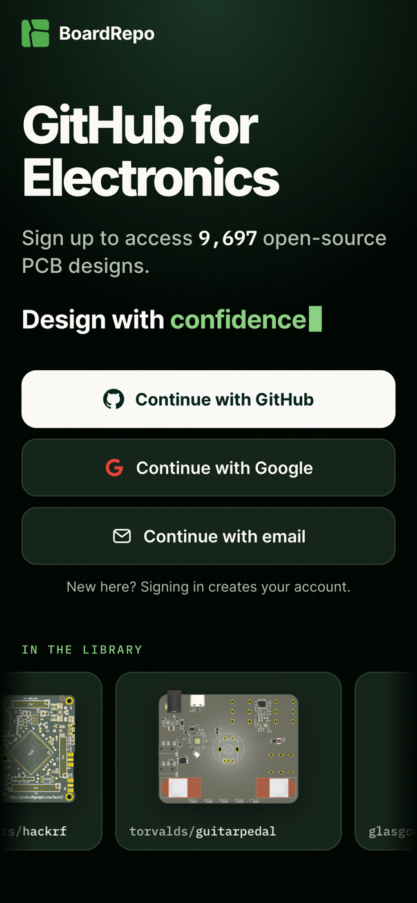
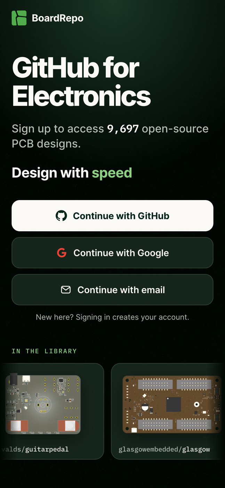
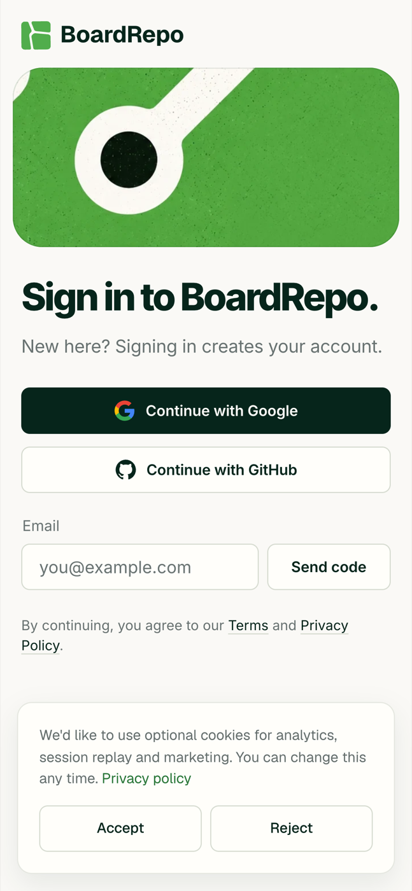
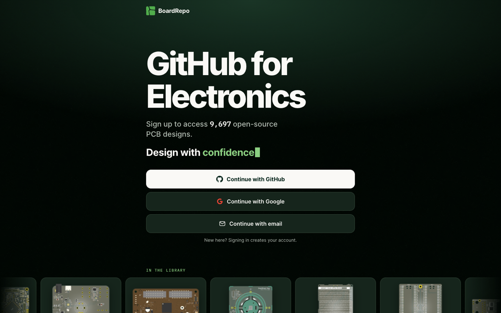

# BoardRepo welcome page (`/welcome/hugh`)

A one-screen signup page for people arriving from Hugh's reels and DMs. They already want in, so
the page states what BoardRepo is, shows the library is real, and puts sign-in one tap away. It is
meant to replace what `boardrepo.com/welcome/hugh` shows today (a redirect to the home page).

One static HTML file, no build step, no dependencies. Open `index.html` through any static server
(`python3 -m http.server`) to preview.

## Screenshots

| Phone (390 px) | Phone, word swapped | Email path: `/signin` | Desktop |
|---|---|---|---|
|  |  |  |  |

## What's on the page

- **Title:** GitHub for Electronics
- **Subline:** Sign up to access **9,697** open-source PCB designs. (the public board count on
  boardrepo.com on 2026-11-21)
- **Swapping line:** "Design with ___". Each word types on, holds about 1.7 s, then deletes for
  the next: references, confidence, speed, a team, a change log. With reduced motion turned on,
  the words switch without typing. Screen readers get the full sentence once.
- **Sign-in:** Continue with GitHub (primary), Continue with Google, Continue with email, then
  "New here? Signing in creates your account."
- **Library strip:** 14 real public boards (HackRF, torvalds/guitarpedal, Glasgow, SmartKnob,
  The Open Book, DeskHop and more) scrolling slowly, each labelled owner/slug. The
  images are the render files your home page already serves (`/api/files/<id>?view=1`).

Mobile first: most visitors come from Instagram's in-app browser. On a 390 px phone the title,
the swapping line and all three buttons fit on the first screen.

## Flow and sign-in targets

| Button | Goes to | What happens |
|---|---|---|
| Continue with GitHub | `/auth/github/start?ref=hugh` | Straight to GitHub's authorize screen, no second choice |
| Continue with Google | `/auth/google/start?ref=hugh` | Straight to Google's account picker |
| Continue with email | `/signin?ref=hugh` | Your sign-in page, which has the email code form (screenshot 3) |

The GitHub and Google buttons skip `/signin` on purpose: otherwise visitors pick a provider here
and then again there. If you build the page into the app, the email button can become an inline
email field that sends the code directly.

## Credit for Hugh (please confirm)

Every entry point we tried sets `br_creator=hugh` (HttpOnly, 30 days) on boardrepo.com before any
redirect: `/welcome/hugh`, `/?ref=hugh`, `/signin?ref=hugh`, `/auth/github/start?ref=hugh` and
`/auth/google/start?ref=hugh`. So the creator should survive the GitHub and Google round trip.
Open questions:

1. Does account creation read `br_creator` and credit Hugh for signups through GitHub, Google and
   email alike?
2. Uploads and MCP connections made later, after the cookie expires: are they tied to the account
   at signup, or to the cookie?
3. Should the page keep `?ref=hugh` on every link? It is harmless if the cookie is already set.

## To wire up in production

- **Live board count:** `<b data-public-boards>9,697</b>` is hard-coded. Fill it from the same
  source as the home page counter.
- **Images:** `FILES` in the script points at `https://boardrepo.com/api/files/`. Served from
  boardrepo.com it can be `/api/files/`. The renders are full size (up to 1568 px, about 300 KB
  each); a 640 px variant would save about 3 MB on phones.
- **Hosting:** serve it at `/welcome/hugh`, in place of the current redirect. Other creator slugs
  could reuse it with their own `ref`.
- **Cookie banner:** your site shows one; on a phone it would cover the bottom of this page's
  first screen.
  Consider showing it after sign-in, or as a slim bar.

## Files

- `index.html`: the page (inline CSS and JS)
- `boardrepo-mark.svg`, `forest-grain.webp`: BoardRepo's own mark and grain texture from
  boardrepo.com
- `fonts/`: Inter (BoardRepo Display is Inter 800) and IBM Plex Mono, both SIL Open Font License
- `screenshots/`: the images above
